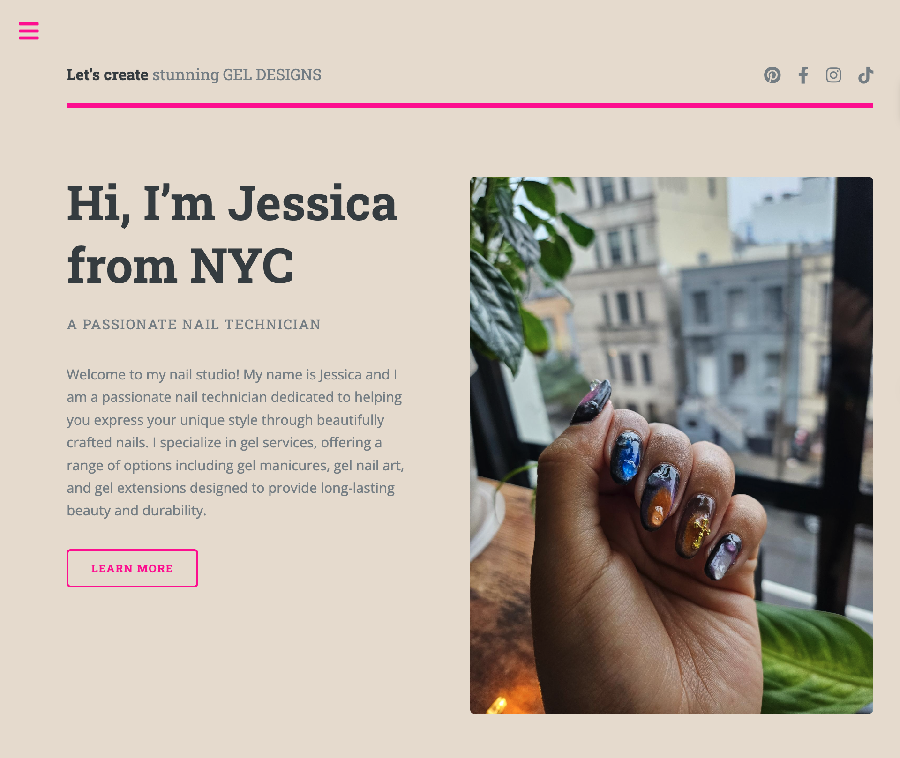
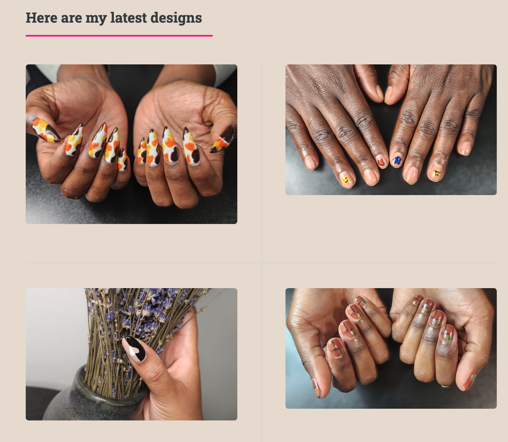

# 💅 Jess Nails It

A website for Jess, a nail artist. Visitors can browse her work, learn about her, and get in touch to book an appointment.

## Demo

Live: [Site](https://jessicanailsit.netlify.app)





## Features

-  Photo gallery showcasing nail designs
-  Services and pricing
-  Contact 
-  Responsive layout that works on desktop and mobile

## Built With

- HTML5
- CSS3
- JavaScript

## Getting Started

1. Clone the repo
   ```bash
   git clone https://github.com/sabrinalindev/JessNailsIt.git
   cd JessNailsIt
   ```
2. Open `index.html` in your browser

No build step or dependencies are required.

## Project Structure

```
JessNailsIt/
├── index.html        # Home page
├── About Me.html     # About page
├── assets/           # 【CSS, JavaScript, fonts 等】
└── images/           # Photos and images
```

## What I Learned

- How to structure a multi-page static website
- How to build a responsive layout with CSS
- How to publish a static site with GitHub Pages


